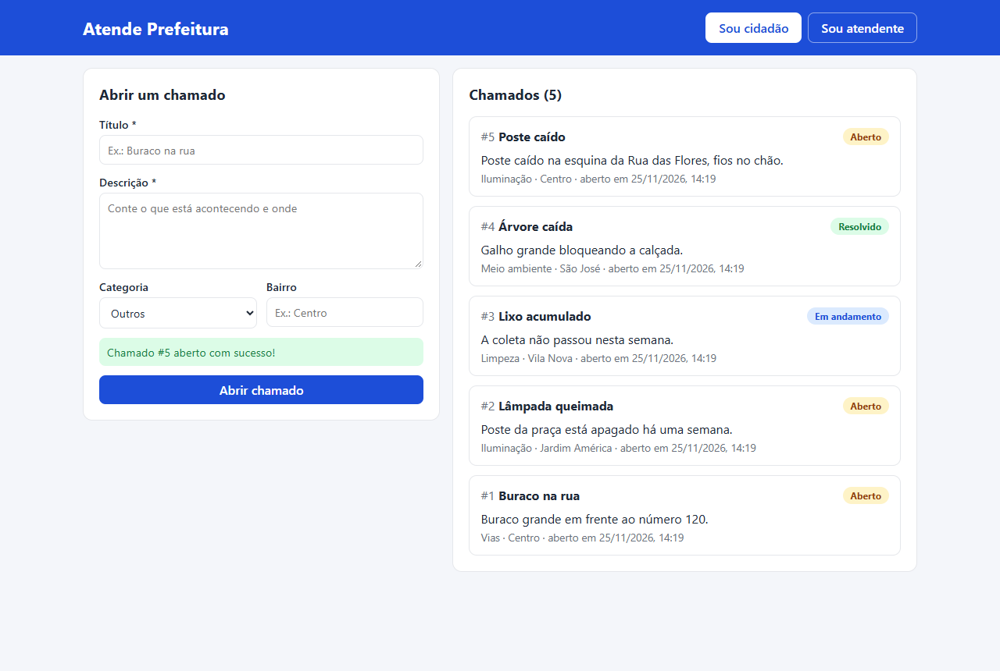
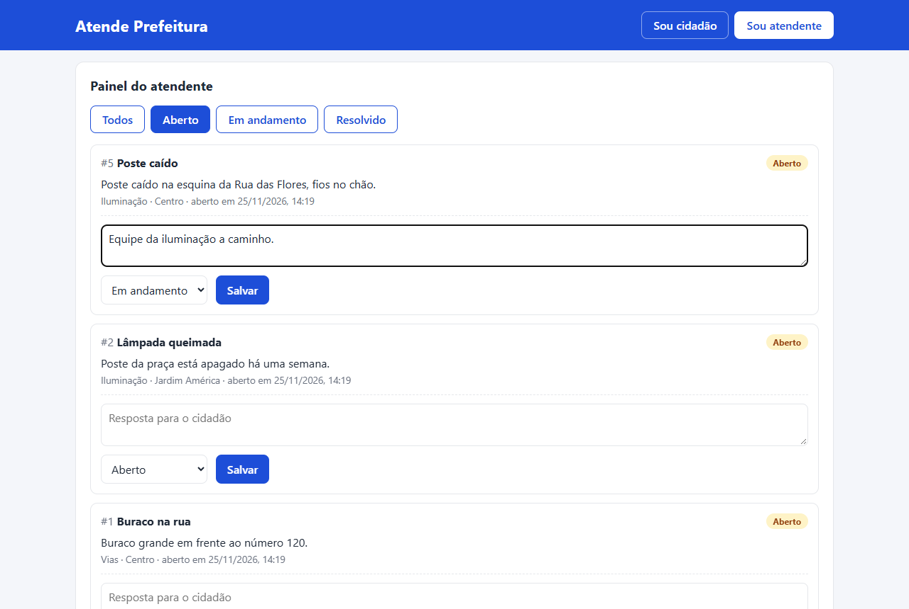
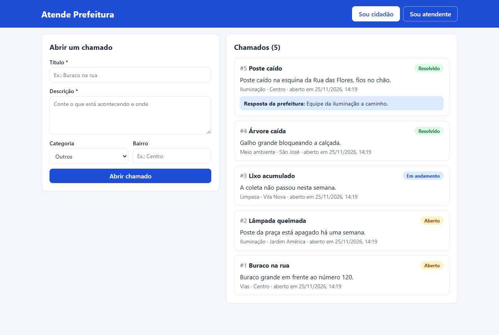
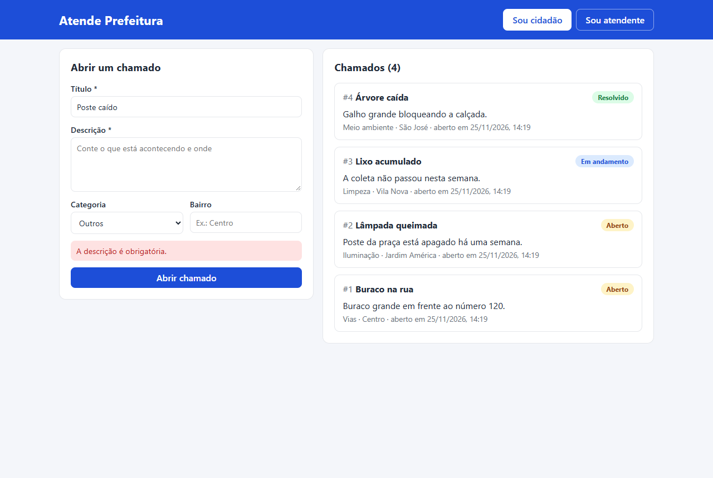
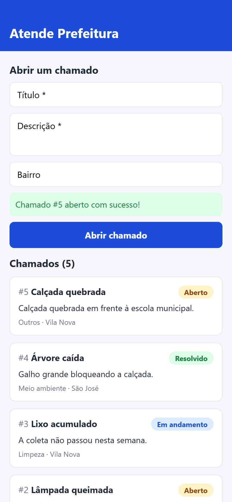

# Atende Prefeitura

Sistema de chamados para prefeituras. O **cidadão** abre um chamado ("buraco na rua", "lâmpada queimada") e acompanha o status. O **atendente** filtra os chamados, responde e muda o status: **Aberto → Em andamento → Resolvido**.

Projeto de estudo full stack: API, banco de dados, testes automatizados, site e app de celular, com o trabalho organizado em Issues, branches e Pull Requests.



## Telas

| Atendente: filtrar, responder e mudar status | Cidadão vê a resposta |
|---|---|
|  |  |

| Validação do formulário | Site no celular | App (Expo) |
|---|---|---|
|  |  |  |

## Tecnologias

| Parte | Tecnologia | Pasta |
|---|---|---|
| API (back-end) | Node.js + TypeScript + Express 5 | `backend/` |
| Banco de dados | PostgreSQL + Prisma 7 | `backend/prisma/` |
| Testes automatizados | Vitest + Supertest (14 testes) | `backend/tests/` |
| Site (front-end) | React 19 + TypeScript + Vite | `frontend/` |
| App de celular (bônus) | React Native + Expo | `mobile/` |

## Como funciona

```
 Site (React)  ─┐
                ├──►  API (Express)  ──►  PostgreSQL
 App (Expo)    ─┘     /chamados           (via Prisma)
```

### Rotas da API

| Método | Rota | O que faz |
|---|---|---|
| `GET` | `/chamados` | Lista os chamados (do mais novo para o mais antigo) |
| `GET` | `/chamados?status=Aberto` | Lista só os chamados de um status |
| `POST` | `/chamados` | Abre um chamado. `titulo` e `descricao` são obrigatórios |
| `PATCH` | `/chamados/:id` | O atendente muda o `status` e/ou grava a `resposta` |

Respostas de erro: **400** (pedido inválido, como chamado sem título ou status fora da lista), **404** (chamado não encontrado) e **500** (erro interno, sem expor detalhes do servidor).

## Como rodar

### 1. O que você precisa ter instalado
- [Node.js](https://nodejs.org) 22 ou mais novo
- [PostgreSQL](https://www.postgresql.org/download/) 15 ou mais novo, com um usuário e senha que você conheça
- [Git](https://git-scm.com)

### 2. Baixar o projeto
```bash
git clone https://github.com/CleitonBitencourtdeSouza/atende-prefeitura.git
cd atende-prefeitura
```

### 3. Criar os bancos de dados
São dois bancos: um para usar e outro só para os testes automáticos (os testes apagam os dados dele). Com o `psql` (troque `postgres` pelo seu usuário):
```bash
psql -U postgres -c "CREATE DATABASE atende_prefeitura;"
psql -U postgres -c "CREATE DATABASE atende_prefeitura_teste;"
```

### 4. Back-end (a API)
```bash
cd backend
cp .env.example .env      # no PowerShell: copy .env.example .env
```
Abra o `backend/.env` e troque `USUARIO`, `SENHA` e a porta (se não for 5432) pelos dados do seu PostgreSQL. Depois:
```bash
npm install               # instala tudo e gera o cliente do Prisma
npx prisma migrate deploy # cria as tabelas
npm run db:seed           # cria 4 chamados de exemplo
npm run dev               # liga a API em http://localhost:3333
```
Para conferir, abra http://localhost:3333/chamados. Deve aparecer a lista em JSON.

### 5. Front-end (o site)
Em **outro terminal**, com a API ligada:
```bash
cd frontend
npm install
npm run dev
```
Abra http://localhost:5173.

### 6. Testes automatizados
```bash
cd backend
npm test
```
Os testes usam o banco `DATABASE_URL_TESTE` do `.env`, nunca o banco principal.

### 7. App de celular (opcional)
1. Instale o **Expo Go** no celular. Ele precisa estar na mesma rede Wi-Fi do computador.
2. Descubra o IP do computador (`ipconfig` no Windows, linha "Endereço IPv4").
3. Crie o arquivo `mobile/.env` com `EXPO_PUBLIC_API_URL=http://SEU_IP:3333`.
4. Rode:
   ```bash
   cd mobile
   npm install
   npx expo start
   ```
5. Leia o QR code com o Expo Go.

## Como o trabalho foi organizado

O projeto segue o mesmo fluxo de uma equipe de desenvolvimento:

1. **Issue:** cada funcionalidade vira uma Issue com o pedido, o critério de "pronto" e como provar. As Issues ficam num quadro do **GitHub Projects** (A fazer → Fazendo → Feito).
2. **Branch:** cada Issue é feita num galho separado (ex.: `feat/banco-prisma`).
3. **Commits pequenos**, com mensagens no padrão `feat:`, `fix:`, `test:`, `docs:` e `chore:`.
4. **Pull Request:** a mudança entra na `main` só depois de revisada, com a prova anexada (saída dos testes, prints). O `Closes #N` fecha a Issue automaticamente.
5. **[DIARIO.md](DIARIO.md):** registra o que pedi à IA (Claude Code), o que ela entregou, **como conferi** e o que estava errado.

## Estrutura de pastas

```
atende-prefeitura/
├── backend/            API (Express + Prisma)
│   ├── prisma/         modelo do banco, migrações e dados de exemplo
│   ├── src/            app.ts (rotas), server.ts (liga a API), db.ts (conexão)
│   └── tests/          testes automatizados
├── frontend/           site em React
├── mobile/             app de celular em Expo
├── docs/prints/        prints das telas
├── DIARIO.md           diário de bordo
└── README.md
```
